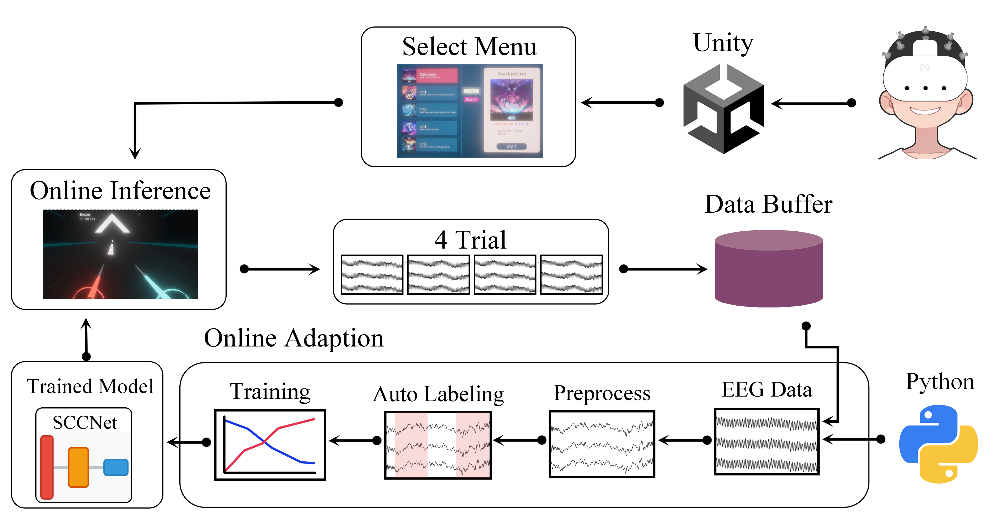
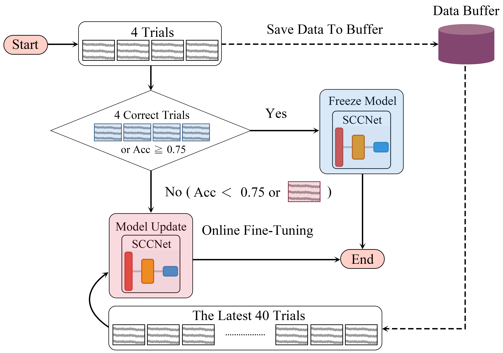
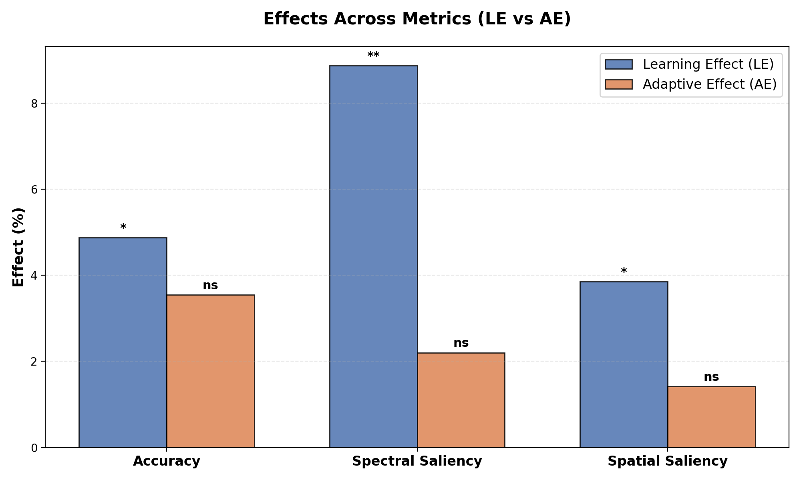
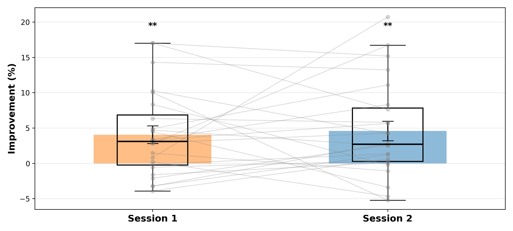
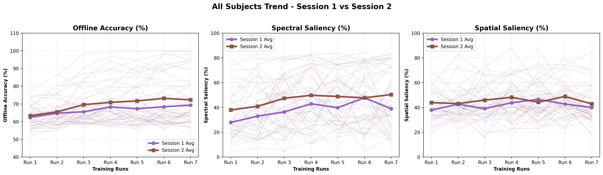
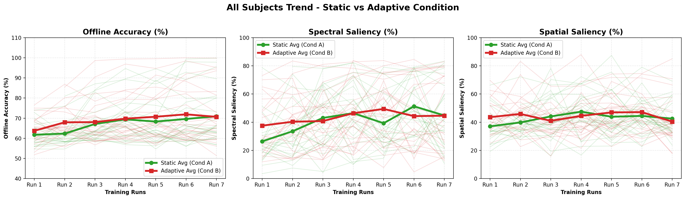
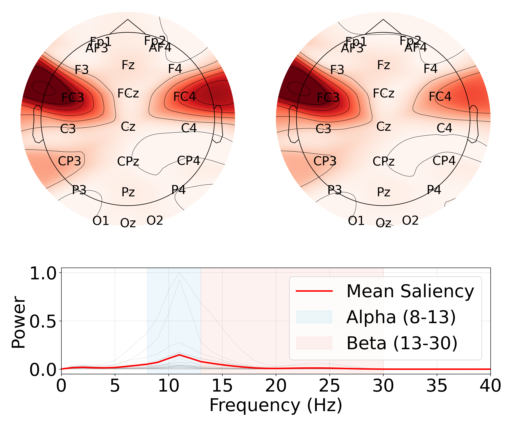

# BeatSaber

This project is variant of VRBCI from github.com/stereomp3/VR_BCI

交接文件: https://hackmd.io/@cecnlCECNL/SkbdNyUmfe



**啟動步驟: Python 執行 `python/main_start.py`，unity 再執行程式碼**。

```bash
python python/main_start.py --subject 01 --session 1                       # 預設：A 控制遊戲，B 在背景同步微調
python python/main_start.py --subject 01 --session 1 --live_model B        # B 控制遊戲
python python/main_start.py --subject 01 --session 1 --live_model auto --start_model A  # 依表現自動切換 (見「雙模型 A/B 平行微調系統」)
python python/main_start.py --subject 01 --session 2 --start_from subject  # A、B 各自接續這個受試者最新的 checkpoint (session | base | subject)
```

線上系統現在同時有 **A、B 兩個模型**，起始模型需放在 `python/main/EEG/checkpoint_main/`：`cA_000.pth` (預訓練 22 通道) 與 `cB_000.pth` (隨機初始化 32 通道，缺少時自動產生)。

現在有新增 v1.0 release 的版本，不需要 VR heatset，直接下載就連接腦波帽就可以測試。

==python 測試 config 需要把 `is_simulated_eeg` 調成 `False`==


# 環境安裝

## unity

安裝版本: 2022.3.622，需要下載 android 版本的內容

unity 直接把 unity 資料夾放入到 unity 就可以開啟，最初開始要等一段時間

實際會用到的場景只有: Lobby (進入點), EEG_Calibration (用於 calibration), MI (腦波遊玩), BeatSaber (這個單純是 BeatSaber)

## Python

建議使用 anaconda 創建一個新的環境，然後再下載對應內容

python 版本: 3.11.8

requirement 在 python 資料夾下面

```
python/conda create --name <env> python/requirements.txt
```

torch install，==注意 torch 需要根據自己的需求下載==，每個人指令會根據電腦設備不一樣

```
pip install --force-reinstall torch==2.3.0 torchvision==0.18.0 torchaudio==2.3.0 xformers==0.0.26.post1 --index-url https://download.pytorch.org/whl/cu121
```

下載完成後，可直接執行專屬環境檢測腳本，一鍵檢查 GPU 加速、CUDA 及所有核心依賴套件（MNE, Captum, Braindecode, PyLSL, XBrainLab 等）：

```bash
python python/check_env.py
```

## 設定檔單一來源 (Single Source of Truth)

專案已整合統一設定檔 `python/config.json`（與 `unity/Assets/StreamingAssets/config.json` 同步）：
- **通道設定切換**：直接修改 `active_channels` 為 `8`, `13`, `22` 或 `32`，Python 端與 Unity 端將同步切換對應的通道 index 與網路參數。
- **TCP 與遊戲設定**：集中設定 TCP Port (預設 `50007`)、IP、`trial_train_interval`、`group_note_num` 等。
- **模擬模式切換**：無實體腦波帽時，可將 `"is_simulated_eeg"` 設為 `true`。

```json
{
  "active_channels": 32,
  "channel_definitions": {
    "8": [2, 3, 4, 5, 6, 7, 8, 9],
    "13": [7, 8, 9, 12, 13, 14, 17, 18, 19, 22, 23, 24, 28],
    "22": [2, 3, 4, 5, 7, 8, 9, 12, 13, 14, 17, 18, 19, 22, 23, 24, 27, 28, 29, 31, 32, 33],
    "32": [2, 3, 4, 5, 6, 7, 8, 9, 10, 11, 12, 13, 14, 15, 16, 17, 18, 19, 20, 21, 22, 23, 24, 25, 26, 27, 28, 29, 30, 31, 32, 33]
  },
  "tcp_network": {
    "host": "127.0.0.1",
    "port": 50007
  }
}
```


# 運行流程圖示

4 個 Trial update 一次，進行 online update (A、B 兩個模型同時微調，詳見「雙模型 A/B 平行微調系統」)




# 程式碼說明

## unity

基本上都放在 `unity\Assets\Script`，~~刪除縣~~的 scirpt 不用管，不是沒用到就是廢棄，而**重點**的部分，就是比較會改到的 script

* Audio
  * AudioManager.cs: 音效處裡 script，透過設定在一個 obj 上面，然後播放各種音效，這個音效一次觸發一個
  * text2speech.cs : 教學模式會用到，其他地方沒用，需要連網路才能用，使用 speak 會講出對應英文，不能說中文。
  * ~~TtsClient.cs~~ : 中文 TTS 會用到，目前暫時沒用
* BeatSaber
  * Effect
    * AudioEmissionController.cs: 根據音樂的大小，讓光線變化 (長條 line 特效)
    * **AutoSaber.cs**: 自動揮砍的判斷，可以設定揮動速度，和延遲幾秒後揮動，這部分需要根據情況微調
    * KeyboardEffect.cs: 光劍碰到地板會有敲琴鍵的特效
    * ~~LongNote.cs~~: 沒用
    * ObjectLinePlacer.cs: 之前用於一次產生多個 note (藍或是紅) 到一個 long note (白色) 上面，現在只有在 calibration 會用到
  * Slicer
    * ~~CubeSlicer.cs~~: 根據 [EzySlice](https://github.com/DavidArayan/ezy-slice) 套件提供的功能，用於測試切砍的程式碼
    * **SaberSlicer.cs**: 實際切砍程式碼，**這邊有送出 flag 的作用**，會送出 CUT 的 flag 到 python
  * SongMapProcess
    * BeatmapData.cs: 定義地圖的內容 結構化的 class
    * **BeatmapSpawner.cs**: 生成 note 的程式碼
    * **BeatSaberInfoLoader.cs**: 讀取基礎資訊，像是 BPM  之類的，和地圖資訊，之後再由 BeatmapSpawner.cs 處裡，兩個 script 黏合性高，這個 script 決定歌曲開始的時間，開始會有延遲，會對應到 forward.cs 裡面動畫時間。
    * CalibrationBeatmapSpawner.cs: 繼承 BeatmapSpawner.cs，針對 calibration 進行設計，不讀取 map，而是人工發送 (**目前版本這個已經沒有使用**，把 Calibration 變成與 Run 一樣 (使用 BeatmapSpawner，不過多了發送 update model 的指令到 python 那邊，然後 python update)
    * SongInfo.cs: 定義歌曲內容，像是圖片，BPM，歌曲名稱 ... 結構化的 class
  * **forward.cs**: 主要 note (音符) 向前的邏輯，裡面 speed 是裝飾，主要要調動畫的長度，因為目前是設定終點，然後在固定時間內到終點
  * ~~PerpendicularVector.cs~~: 沒用
  * ~~RotateTransforms.cs~~: 沒用
* ~~EEG~~
  * ~~AutoFistWithOVR.cs~~: 偵測使用者握拳，測試用。沒用
  * ~~EEGTrain.cs~~: 傳統訓練會用到，用於 EEG_v2
  * ~~HandFistChecker.cs~~: 偵測使用者握拳。沒用
* FadeEffect: 裡面只有材質有用
  * ~~FadeEffect.cs: 沒用~~
  * ~~HeadCollisionDetector.cs~~: 沒用
  * ~~HeadCollisionHandler.cs~~: 沒用
* FileProcess
  * **NoteLogTrigger.cs**: 放在 long note 上面，會觸發 start 和 end 的 log，發送給 python，標註 Label
  * TimeLogger.cs: 用於紀錄 LOG 到本地端
* ~~Hand~~: 沒用到
* ~~LCK~~: 用於錄影的功能，不會用到
* Lobby
  * FadeScreen.cs:  裡面放過場特效，螢幕黑，貼在玩家眼前
  * SceneTransitionManager.cs: 過場切換，時間控制
  * SetOptionFromUI.cs: 設定 option 的 UI 控制 (音量)，目前還沒有相關設定
  * Song_UI_shower.cs: 設定 UI，並顯示對應歌曲，這個會有多個，每個 script 對應一首歌曲，裡面放入對應的 SO
  * SongSelectMenu.cs: 這個只有一個，並且會記錄玩家選擇的歌曲狀況，透過 Song_UI_shower.cs 裡面的 song，可以存內容到 json 裡面，然後到 MI 場景就可以透過 json load 對應歌曲難度以及是什麼歌。與 Song_UI_shower.cs 黏合性高
  * UIAudio.cs: 直接播放音源，用於按鈕的觸發控制
* ~~LSL~~: 之前的傳輸方式，現在不會用到
* Manager
  * GameDataManager.cs: 場景切換，這個 script 還會在，紀錄需要固定的資料，目前只有存放有哪些模型 (可以提供玩家選擇)
  * GameManager.cs: 紀錄遊戲中各種 event，並有註解是在那裡觸發，以及是在那裡加入，裡面還會記錄遊戲中一些動態資料像是分數
  * SceneLoaderManager.cs: 可以觸發場景切換的 script
  * ScoreManager.cs: 紀錄分數
* SO: Scriptable Object，創建 SO，有點像是創建一個 data 紀錄器，然後可以根據不同 data 進行挪用
  * Song.cs: 歌曲的 SO
  * SongEditor.cs: Song.cs SO 編輯器，會根據使用者輸入對應內容 real time 寫入 SO 內容
* Static
  * Config.cs: 儲存設定檔案，像是連線 IP 位置、group 設定多少、傳輸使用字串 ... 紀錄不會動的變量
  * StreamingAssetLoader.cs: 讀取歌曲的時候會用到的 static library
  * ~~WAVUtility.cs~~: 目前沒用到，如果後續有寫 LLM TTS chinese server 才會使用
* TCP
  * TCP_Client.cs: 負責處裡 python 的傳輸
* UI : UI 互動，蠻多地方會加入 event 的，讓 程式碼 呼叫功能的時候， UI 可以做對應更動
  * DebugUI.cs
  * GameStartMenu.cs
  * OptionMenu.cs
  * SelectModelButtonUI.cs
  * SelectModelUI.cs
  * TrainingLogUI.cs
  * TutorialContinueUI.cs

## Python

==提示: 可直接於 `python/config.json` 統一修改 `is_simulated_eeg`（預設 `false`，無腦波帽時可設為 `true`），若連線失敗系統亦會自動啟動友善模擬回退保護。==

執行程式碼，會根據 unity 那邊選取歌曲，把使用者資料存入到 `real_time_data` 下面，會根據 run 儲存 csv (data) 與 txt (label)，儲存的 pt 為 calibration 加入到 buffer 裡面的 data。

程式碼執行的時候，在訓練完成模型會拿取 loss 最低的，然後放入到 `EEG/checkpoint_main` 下面，A 存成 `cA_xxx`、B 存成 `cB_xxx` 的形式 (例如 `cA_001.pth`、`cB_001.pth`)。

### 1. 快速測試工具集 (`python/tools/`)

專案提供兩個獨立快速測試工具，供開發者快速驗證訊號串流或個別模型：

- **線上即時 LSL 串流與 Unity 快速測試** (`python/tools/online_test_lsl_to_unity.py`)：
  可在不啟動完整遊戲狀態機的情況下，單獨驗證腦波帽訊號讀取、濾波、模型推論至發送 LSL Marker 給 Unity：
  ```bash
  # 模擬訊號模式 (無實體腦波帽時)
  python python/tools/online_test_lsl_to_unity.py --simulated --channels 22 --model SCCNet
  
  # 連接實體 Cygnus 腦波帽模式
  python python/tools/online_test_lsl_to_unity.py --channels 32
  ```

- **單檔快速模型訓練與驗證** (`python/tools/quick_trainer.py`)：
  快速測試特定受試者的 `.pt` 檔案，或使用合成 Demo 資料快速驗證模型訓練收斂性：
  ```bash
  # 使用 Demo 平衡資料快速驗證訓練流程
  python python/tools/quick_trainer.py --demo --channels 22 --model SCCNet --epochs 20
  
  # 指定具體 .pt 資料檔案訓練
  python python/tools/quick_trainer.py --pt_files path/to/run1/data.pt path/to/run2/data.pt --channels 13 --epochs 50
  ```

### 2. 隨機模型初始化與通道不匹配 (Size Mismatch) 自動修復

當在 `config.json` 切換通道數（例如從 32 改為 13 或 22 通道）時，預設權重可能會產生維度衝突。本專案具備**雙重保護機制**：
- **自動產生機制**：即時預測 (`EEGPrediction.py`) 與線上微調 (`MI_train.py`) 載入 Checkpoint 時，若**檔案不存在**，系統會即時生成符合當前通道數的隨機初始權重並存檔 (例如第一次啟動時的 `cB_000.pth`)。
- **維度不匹配時直接報錯，不會覆蓋檔案**：舊版會把不匹配的 Checkpoint 以隨機權重覆蓋，現在改為拋出錯誤，避免弄丟預訓練模型 (例如把 22 通道模型誤放進 32 通道設定)。每個 Checkpoint 會記錄 `n_chans`，預測器依此自動從 32 通道 buffer 取出該模型的通道子集 (22 通道預訓練模型可在 `active_channels: 32` 下使用)。
- **手動隨機模型產生工具** (`python/main/EEG/generate_random_models.py`)：
  可隨時手動為所有架構（`SCCNet`, `ShallowFBCSPNet`, `EEGNetv4`, `EEGConformer`, `ATCNet`）產生隨機權重：
  ```bash
  # 為指定通道 (如 22 通道) 產生隨機模型
  python python/main/EEG/generate_random_models.py --channels 22
  
  # 一鍵為 8, 13, 22, 32 全數產生隨機模型
  python python/main/EEG/generate_random_models.py --all_channels
  ```

---

### 3. 主系統模組說明 (`python/main`)

* `main_start.py`: 系統啟動主入口 (啟動 TCP 伺服器與遊戲狀態機)
* `game_state.py`: 遊戲狀態機 (管理 Lobby, Calibration, MI, BeatSaber, Training 狀態切換)
* `EEG/`
  * `checkpoint_main/`: 放主要模型資料夾 (出現在 Lobby 模型選擇清單中，包含 `cA_000.pth` (A 起始模型)、`cB_000.pth` (B 起始模型)、`model.pth`；微調後依序產生 `cA_001.pth…`、`cB_001.pth…`)
  * `checkpoints/`: 訓練暫存模型資料夾 (儲存各 Epoch 模型權重)
  * `CygnusEEGReader.py`: Cygnus 腦波資料讀取與 buffer 管理 (具備友善離線自動回退模擬)
  * `EEGPrediction.py`: 即時腦波特徵推論與 Unity Marker 發送 (A、B 各一個 predictor，只有 live 的送給 Unity；依 checkpoint 的 `n_chans` 取通道子集)
  * `EEG_Train.py`: 線上自適應訓練排程、Replay Buffer 管理與 FT Pipeline (A、B 兩個 `_ModelSlot` 以兩條執行緒平行微調、live 模型選擇)
  * `MI_train.py`: 線上模型微調與訓練器核心
  * `data_process_np.py`: 讀取 CSV / Log 並提取為 Numpy 腦波 Epoch
  * `models.py`: 定義 SCCNet 等客製模型架構
  * `generate_random_models.py`: 隨機模型初始化與維度修復工具
* `Utils/`
  * `config.py`: 集中讀取 `config.json`，管理所有網路、通道與演算法常數
  * `global_value.py`: 跨執行緒動態共用狀態 (目前模型名稱、執行緒 Lock、A/B checkpoint 路徑、live / broadcast 模型、vote flag、預測紀錄等)
  * `trial_scoring.py`: Unity 式逐 trial 計分 (CUT / WRONG_CUT + 同時間重算的 100 筆加權投票)、vote flag、`predictions.csv`、END 行 `MODEL_PREDICTION` 文字
  * `TCPServer.py`: 高可靠性 TCP 伺服器，負責與 Unity 雙向傳遞狀態與控制字串
  * `UnityMarkerReader.py`: 解析 Unity 傳送之事件 Marker 與狀態切換
  * `file_pointer_reader.py`: 指標式增量 CSV/Log 讀取器 (避免 Calibration 重複讀取檔案，大幅加速)
  * `preprocess.py`: 帶通濾波、去均值與特徵前處理
  * `some_functions.py`: 檔案命名與版本號自動遞增工具 (`get_next_version_path(base, prefix)` 取現有最大編號 + 1，A 用 `cA_`、B 用 `cB_`；`resolve_start_checkpoint` 實作 `--start_from`)


### 4. 雙模型 A/B 平行微調系統

系統同時維護兩個模型，只有 live 的那個把預測送給 Unity (B 預設不影響遊戲)。**每個 block 兩個模型各自判斷要不要微調**：用 Unity 的真實投票結果計分，只有「本 block 有錯、且本 run 的正確率 < 0.75」的模型才微調，兩個模型每個 block 都會把資料存進自己的 Replay Buffer。

| | A | B |
|---|---|---|
| 起始模型 | `cA_000.pth`，預訓練，22 通道 | `cB_000.pth`，隨機初始化，32 通道 |
| 使用通道 | 從 32 通道 buffer 取 22 通道 (`config.json` 的 "22" 通道組) | 32 通道 |
| Checkpoint 鏈 | `cA_001, cA_002, …` | `cB_001, cB_002, …` |
| Replay Buffer / 暫存檔 | 各自一個 `ReplayBuffer`、`ftA-*.pth` | 各自一個 `ReplayBuffer`、`ftB-*.pth` |

**Unity 送出的 log (TCP，一行一則)**

```text
Trial 8 START: 1791884622.154 LABEL: 0 MODE: Adaptive
Trial 8 WRONG_CUT: 1791884626.400            # 腦波投票錯誤的那一刻 (投對時是 Trial N CUT: <ts>)
Trial 8 END: 1791884627.097 LABEL: 0 MODEL_PREDICTION: A=1 B=0 LIVE=B AT: 1791884626.400   # MODEL_PREDICTION 由 Python 寫入 log
```

- 每個 trial 最多一行 `CUT` (投對) 或 `WRONG_CUT` (投錯)，都是 Unity `AutoSaber` 投票當下記錄的。舊版 Unity 沒有 `WRONG_CUT`/`MODE`，Python 會退回舊行為 (沒有 CUT 視為錯，投票時間用 END − `prediction_log_offset_s`)。
- `AT` = 該 trial 的投票時間 (CUT / WRONG_CUT 的時間戳；沒有則 END − 0.70 秒，`eeg_settings.prediction_log_offset_s`)。`A=` / `B=` 是 Unity 投票的複製：該模型 AT 之前最近 100 筆預測，權重由舊到新 1 到 5，`count1 >= total/2` 則為 1；預測不足 2 筆為 `NA`。`LIVE=` 是投票當下實際送預測給 Unity 的模型。
- `WRONG_CUT` 要重新編譯 `unity_noVR` 才會出現 (`TimeLogger.cs` 的 `LogType.WrongCut`、`AutoSaber.cs` 兩個 `wrong_hit += 1` 處)。`unity/` (VR 版) 沒有改。

**計分 (Unity 式，`trial_scoring.score_block`)**
- 投票時間 = CUT / WRONG_CUT 的時間戳 (沒有則 END − 0.70 秒)。
- 當時送預測的模型：CUT = 對，WRONG_CUT 或沒有 CUT = 錯 (Unity 的真實結果)。
- 另一個模型：在同一個時間點重算 Unity 的最後 100 筆加權投票，與 label 比對。
- 整個 trial 的多數決不再線上計算；所有預測存在 `run{N}/predictions.csv` (model, time, pred, prob1)，可事後重算。

**觸發與微調 gate (每 `trial_train_interval` = 4 個 trial)**

```text
Python 在第 4、8、12… 個 trial (編號 3、7、11…) 的 END 行寫入 log 之後，舉起與 Unity 的 calibration_start 相同的旗標
  條件：該 run 的 START 行有 MODE 且 (MODE=Adaptive 或本 run 是 Calibration 歌曲，即收到過 Calibration stage 訊息；Unity 之後會立刻送 MI，所以用 `global_value.is_calibration_run` 旗標，不看 stage 字串)；此時忽略 Unity 自己送的 calibration_start / "Don't update model"
  舊版 Unity (START 沒有 MODE)：照舊，跟著 Unity 的 calibration_start
main loop 每 1 秒檢查一次旗標：
  1. saveDataAsPtFromPointer()：把新 trial 存成 data_*.pt (多存 trial_ids)
  2. ft_pipeline.run_calibration()
       a. 計分 (微調之前)                                                -> trial_scoring.score_block
       b. 決定 live 模型 (固定 A / B，或 auto 的連續 block 規則)          -> EEG_Train._decide_live
       c. 每個模型的 gate：本 block 至少錯 1 個 trial 且本 run 累計正確率 < finetune_acc_threshold (0.75)
       d. A、B 各一條執行緒：block 的 window 一定先加入自己的 ReplayBuffer；gate 打開才微調並存成新的 cX_NNN
       e. 寫入 run{N}/ab_blocks.csv，廣播 "calibration done"
  3. game.dump_predictions()：整份重寫 run{N}/predictions.csv (每個 block 都存，Ctrl+C 也不會全部遺失；進 Training 與回 Lobby 時也存)
  4. game.swap_in_new_models()：沒有任何模型被微調且 live 模型沒變就略過 (不等、不 reload、swap_time 留空)；否則等 vote flag 關閉 (Unity 不在快要投票的時間窗) 後才 reload_predictors
平常：A、B 兩個 predictor 執行緒同時讀同一份 EEG buffer，各自記錄預測 (時間、預測、機率)；只有 live 的送給 Unity
```

- 每個 run 的累計正確數 (每個模型一份) 在 `global_value.runCount` 改變時重設；`finetune_acc_threshold` 在 `online_adaptation` 設定。

**SPRT 微調 gate (`online_adaptation.finetune_gate = "sprt"`，預設)**

上面的 block gate 改成 `"block"` 就會完全照舊。`"sprt"` 時 (只在 START 有 MODE 的新版 Unity；舊版 Unity / VR 專案照舊走 block 路徑)：

```text
每個 trial 的 END 之後 (Adaptive 或 Calibration 歌曲) -> main loop -> SprtTicker.tick (python/main/EEG/sprt_finetune.py)
  1. 用自己的 log pointer 讀新結束的 trial，score_block 計分 (live 用 Unity 的 CUT / WRONG_CUT，另一個用重算的投票)
  2. A、B 各一個 SprtGate (python/main/Utils/sprt_gate.py)：對 +ln(p1/p0)，錯 +ln((1-p1)/(1-p0))
       分數 <= ln(beta/(1-alpha)) -> 立刻微調這個模型；分數 >= ln((1-beta)/alpha) -> 夠好，不微調；兩種都歸零繼續
     每個 trial 寫一行 run{N}/sprt_trials.csv (trial, model, live, correct, step, score, decision, p0, p1, alpha, beta)
  3. 有模型要微調、或 4-trial block 結束：存上次存檔之後的 trial，run_calibration (兩個 buffer 都加入；只微調要微調的模型)
     ab_blocks.csv 多 trigger (sprt = 中途微調，block = block 結束)、sprt_A、sprt_B 欄
```
- 分數在每個 run 開始、以及該模型微調完成後歸零；新權重載入之前投票的 trial 記為 `stale`，不算進新模型。
- live 模型切換 (`--live_model auto`) 仍然只在 4-trial block 結束時，用這 4 個 trial 的分數判斷。
- 參數 `sprt_p0` / `sprt_p1` / `sprt_alpha` / `sprt_beta` (預設 0.65 / 0.85 / 0.05 / 0.2)：對 +0.268、錯 −0.847；分數從 0 開始時，2 個 trial 連錯就微調、11 個連對判定夠好；正確率約 76% 時分數不會往任何一邊走。選 76% 是因為 F2 反事實分析：run 正確率低於 0.75 時微調平均 +2.6 pp，0.80 以上約 0 (2026-11-17 之前是 0.5 / 0.75，約 63%，微調太少)。收集資料後要重新檢查 (`docs/known_issues.md` M5)。
- 離線比較：`python/analysis/sprt_gate_replay.py` (輸出 `python/analysis/results/sprt_gate_replay/`)。
- **失敗權重 (每個模型各自)**：失敗的 trial 在訓練與驗證 loss 裡權重 ×2。`success_cut_count` (`game_settings`，新 log 為 1，舊資料為 5)：有 WRONG_CUT 或 CUT 數不足就是失敗。當時送預測的模型沿用 Unity 的結果，另一個模型的失敗 = 它重算的投票是錯的。`data_process_np.py`、`else/preprocessing/create_MInp.py` 規則相同。

**Replay Buffer 與訓練分開**
- `MI_train.ReplayBuffer`，每個模型一個 (`_ModelSlot.buffer`)：`add(dataset)` (FIFO)、`train_set()`、`val_set()`、`sizes()`。`OnlineCalibrationTrainer.train(train_set, val_set)` 只負責訓練 (4 epoch、batch 8、Adam 2 × lr、加權 CE、驗證 loss 最低的 epoch 存成 `{tag}-best.pth`)。
- 已移除 `global_value.replay_buffer`，離線模擬腳本 `else/pretraining/phase2_calibration_sim.py` 已刪除 (git 歷史可找回)。
- 建立於 Python 啟動時、跨 run 保留在記憶體、**不寫入磁碟**，重開 Python 後為空。每個 buffer 只被自己的微調執行緒使用，不需要 lock。

**模型換入時機 (vote flag)**
- vote flag 從 START + (投票 offset − `swap_guard_s`) 開啟，CUT / WRONG_CUT 到達 (或 END，保險) 時關閉；新權重只在 flag 關閉時載入，等待有 3 秒上限。
- 投票 offset：run 的第一個 trial 用 `vote_offset_s` (4.25)，之後用該 run 實測的 START 到投票秒數 (換歌曲也會自動適應)。
- 實際送預測的模型 (`global_value.broadcast_model`) 只在 `reload_predictors` 套用 live 旗標時改變，每個 trial 投票當下的值記在 `global_value.trial_live`，計分以它為準。
- `ab_blocks.csv`：原有欄位位置不變，新增 `ft_A, ft_B` (該 block 是否微調)、`ft_seconds` (本 block 微調所花時間)、`swap_time` (新權重載入時間)。

**Checkpoint 位置與起點 (`--start_from`)**
- `python/main/EEG/checkpoint_main/` 保留起始模型 (`cA_000`、`cB_000`、`model.pth`)，Unity 大廳仍列出這裡的模型。
- 微調後的 `cA_NNN` / `cB_NNN` 存到 `real_time_data/sub{S}/ses{N}/checkpoints/`，第一個檔案是 `001`；編號一律取「現有最大編號 + 1」，最大的永遠是最新的 (刪掉中間的檔案也不會被補回)。
- `--start_from session|base|subject` (預設 `session`)：`session` = 這個 session 最新的，沒有就用 base；`base` = 永遠從 `cA_000` / `cB_000` 開始；`subject` = 這個受試者編號最大、有 checkpoint 的 session 的最新一個。A、B 分開決定 (例如 `cA_009` 與 `cB_012`)，與 `--live_model`、`--start_model` 無關。**注意**：`subject` 時 A、B 各自往前找，所以可能來自不同 session (例如 A 來自 ses2、B 來自 ses1，A、B 各自 gate 時很正常)；這是預期行為。啟動時 `setup_args` 會印出 A、B 各自的來源資料夾，來自不同資料夾時多印一行 WARNING。

**live 模型選擇 (`--live_model`)**
- `A` / `B`：固定。
- `auto`：最初由 `--start_model` (預設 A) 控制。每個 block 以上面的 Unity 式計分算 trial accuracy；**另一個模型連續 `switch_streak` 個 block 的 trial accuracy 嚴格較高**才切換，平手或較低則重新計數。
- `switch_streak` 在 `python/config.json` 的 `online_adaptation` 設定 (預設 2，最小 1)。4 個 trial 的 accuracy 只有 0 / 25 / 50 / 75 / 100%，兩個接近隨機的模型仍有約 13% 的 block 配對會造成切換。

**Replay Buffer 容量 (可保存的 calibration 資料)**
- 每個類別最多 `replay_buffer_limit` = **384 個 window** (`config.json` 的 `eeg_settings`；程式內建預設為 320)；超過時丟掉最舊的 (被擠出的 window 會進驗證部分；驗證部分也會收納新進的 window，上限為 40% = 153 個 window / 類別)。
- 流程：`data_*.pt` 存每個 trial 的前 2000 點 (4 秒)、label、failure、trial_ids → 每個模型取自己的通道 → 每個 trial 切成 16 個 window (500 點、stride 100)，去通道均值並帶通 → 4 個 trial 的 block 有 64 個 window。384 = 24 trial × 16 window，約容納一個 run (48 trial，每類 24 個)。
- 記憶體：滿的時候 A 約 47 MB、B 約 69 MB。預測紀錄每個模型保留最近 60000 筆 (約 11 分鐘)。

**啟動順序與警告 (Python / `game.exe`)**
- 先啟動 Python，看到 `歡迎來到遊戲大廳！` 之後再開 `game.exe`。Unity 會每 1 秒重試連線，右上角標籤顯示 `Python: connected` (綠) / `Python: not connected` (紅)；連線前送出的訊息 (最多 50 則) 會在連上後依序補送。
- `WARNING: Waiting for Unity connection`：Python 已連上 LSL (`Connected to LSL stream` 之後開始檢查)，但 3 秒內沒有任何 Unity 連線，之後每 5 秒重複，直到連上。
- `WARNING: Connection to unity lost`：Unity 曾連上、現在沒有連線 (例如關閉 `game.exe`，或換場景時舊連線被關閉)，每 5 秒重複；Unity 重連後警告停止。
- `WARNING: Trial data received in Lobby (Unity stage message lost); not used for training`：Python 還在 Lobby 狀態卻收到 trial 訓練旗標 (Unity 的 stage 訊息遺失)。這些 trial 不會被拿去訓練；進入 Calibration / MI 時 Python 也會把 LOG pointer 移到檔尾，並印出略過的 trial 行數。資料仍留在該 run 的 log / CSV。
- 已知問題：歌曲進行中 Unity 斷線時沒有斷線面板，只有右上角標籤變紅。

**測試與注意事項**
- 測試：`python python/tests/test_parallel_finetune.py` (不需要 Unity 與腦波帽)。
- 同一個 trigger 沒有新資料時 (例如 log 行數不足) 不會重複訓練舊資料，但仍會廣播 `calibration done`。
- 某一條微調執行緒失敗時另一個模型照常完成，失敗的模型維持舊 checkpoint，並記錄在 `ab_blocks.csv` 的 `failed` 欄位。
- 已知但未處理的問題：auto 切換在 4-trial block 上很吵；訓練只用每個 trial 前 4 秒；重開 Python 後 buffer 為空；驗證資料大多是訓練資料；微調時間 (最長約 8 到 9 秒) 只量測不縮短；main loop 每秒輪詢一次；TCP 訊息沒有 framing；Static run 不計分。
- GPU：RTX 50 系列 (Blackwell) 需要 PyTorch 2.7 以上 (CUDA 12.8)；上面固定的 `torch==2.3.0+cu121` 不支援。升級後 `torch.load` 預設 `weights_only=True`，載入含 numpy 的 `.pt` 需加上 `weights_only=False`。


> 在 `python/else` 資料夾的部分（離線分析、模型訓練與特徵管線）

```text
python/else/
├── pipeline.py                      # 【一鍵全自動總管主程式】(整合前處理、訓練、統計出圖與受試者分群)
├── metrics_summary.csv              # 【指標資料庫】(儲存 24 位受試者跨 Session 與 Run 的完整特徵數據)
├── charts/                          # 【成果圖表目錄】(自動輸出所有長條圖、箱型圖、趨勢圖與 WSI 分析圖)
│
├── preprocessing/                   # 【1. 資料前處理】
│   └── create_MInp.py               # 將受試者原始 EEG CSV 與 Log 檔轉換為 MI / Resting 的 .pt 檔案
│
├── training/                        # 【2. 模型訓練與交叉驗證】
│   ├── Models.py                    # 模型架構定義 (SimpleEEGNet, SCCNet 等)
│   ├── MI_train.py                  # 訓練與微調引擎 (BraindecodeTrainerCV 等)
│   ├── train_cv.py                  # 交叉驗證訓練核心與 Saliency 特徵生成引擎
│   ├── 4_fold_CV_13.py              # 13 通道單 Run 獨立訓練入口 (產生 record.pkl、epochs.pkl)
│   ├── 4_fold_CV_13_all.py          # 13 通道全 Session 合併訓練入口
│   ├── 4_fold_CV_22.py              # 22 通道單 Run 獨立訓練入口
│   └── 4_fold_CV_22_all.py          # 22 通道全 Session 合併訓練入口
│
├── analysis/                        # 【3. 指標整合、統計與出圖】
│   ├── analyze_metrics_and_plot.py  # 日誌解析、持久化儲存 CSV、Table 1-3 統計檢定與核心繪圖
│   ├── subject_stratification.py    # 受試者多維度分群篩選與特徵診斷系統
│   ├── compute_saliency_metric.py   # Saliency 指標 (Spectral / Spatial Saliency) 表格生成
│   ├── generate_metric_ttest.py     # Table 1-3 統計檢定與線性混合效應模型 (LMM)
│   ├── generate_metric_plot.py      # 長條圖與箱型圖繪製模組
│   ├── generate_metric_WSI.py       # Within-Session Improvement 專用分析
│   └── generate_metric_sum01.py     # 分群相容轉接外殼 (轉接 subject_stratification.py)
│
├── neuro_analysis/                  # 【4. 神經生理特徵與腦波診斷】
│   ├── TFA2.py                      # BCI 4-Panel 時頻分析 (PSD、Time-domain、Energy) 與特徵自動檢驗
│   ├── erd_topomap_analysis.py      # 全局 ERD 空間地形圖 (Topomap) 與 7 Run 學習演化軌跡
│   └── eyes_movement_detect.py      # 眼動 EOG 作弊檢定與異常波形繪製 (Fp1, Fp2 異常檢出)
│
├── saliency_plot/                   # 【5. Saliency 空間圖與 PSD 綜合視覺化】
│   ├── draw_saliency_topo_PSD.py    # 批次繪製單一受試者 Saliency Topomap 與 PSD 複合圖
│   ├── draw_saliency_topo_PSD_all.py# 將全部受試者合併為 7x24 矩陣大圖
│   └── draw_saliency_topo_PSD_pair.py# 繪製同受試者跨 Session 成對比較圖
│
├── hardware_analysis/               # 【6. 硬體效能與參數優化】
│   ├── find_hardware_performance.py # 解析即時日誌中的推論延遲、TCP 延遲與 FPS
│   ├── plot_hardware_performance.py # 繪製 4 款模型在各 Epoch 下的延遲變化
│   ├── nasa_tlx_charts.py           # 繪製 NASA-TLX 認知負荷問卷分析圖表
│   └── find_best_parameter.py       # 萃取 online_simulation 日誌找出最佳超參數組合
│
├── music_tools/                     # 【7. 歌曲地圖與音樂情緒工具】
│   ├── download_models.py           # 自動下載 Essentia MusiCNN 預訓練骨幹模型與標籤
│   ├── music_analyzer2.py           # MusiCNN 音樂情緒/風格一致性分析與離群值檢測
│   ├── dat_process.py               # 根據間隔過濾刪除多餘 Note
│   ├── create_note_data.py          # 自動產生 note，可以用於 AI 生成音樂
│   └── map3to2.py                   # 歌曲 Map v3 轉 v2 格式相容轉換工具
│
└── utils/                           # 【8. 通用共用工具庫】
    └── common_utils.py              # 常數配置、Tee 日誌、帶通濾波、資料整理與共用統計檢定工具
```

---

### 如何跑完整個 Pipeline 

本系統提供**一鍵主管線 (`pipeline.py`)**，整合了從原始腦波資料處理到產出論文級統計表與圖表的完整生命週期。

#### 1. 一鍵全自動執行
只要一個指令，自動依照順序執行「資料轉換 -> 4-Fold CV 訓練 -> 日誌解析與 CSV 建立 -> 統計檢定與出圖 -> 受試者分群篩選」：

```bash
# 全流程執行
python python/else/pipeline.py --step all --channels 13 --base_dir /mnt/project/MIEXP/DATA_Cygnus --csv_path metrics_summary.csv --plot_dir /path/to/your/file
```

#### 2. Fast Mode from CSV
若已具有指標資料庫 `metrics_summary.csv`，可在 **1~2 秒內直接產出成果**：

```bash
# 產出 Table 1-3 統計檢定表與 4 大核心成果圖表至 charts
python python/else/pipeline.py --step plot

# 執行受試者多維度分群篩選報告
python python/else/pipeline.py --step stratify
```

#### 3. 分階段逐步執行 (Step-by-Step Execution)
若需要單獨除錯或調整特定階段參數，可透過 `--step` 參數分別調用：

##### 1：資料前處理 (`create_np`)
將原始 EEG CSV 與 Log 檔轉換為 MI 與 Resting 的 `.pt` 格式，預設開啟標籤平衡排序 (`--arrange_by_label`)：
```bash
python python/else/pipeline.py --step create_np --channels 13 --base_dir "/mnt/project/MIEXP/DATA_Cygnus"
# 或直接調用子模組：
python python/else/preprocessing/create_MInp.py --channels 13 --base_dir "/mnt/project/MIEXP/DATA_Cygnus"
```

##### 2：4-Fold Cross Validation 與 Saliency map 特徵產出 (`train`)
自動依據受試者各 Run 訓練 SCCNet 模型，並透過 Saliency / NoiseTunnel 運算顯著性特徵權重：
```bash
python python/else/pipeline.py --step train --channels 13 --train_mode both --epochs 100
# 或直接調用個別訓練 python：
python python/else/training/4_fold_CV_13.py --epochs 100
python python/else/training/4_fold_CV_13_all.py --epochs 100
```

##### 3：指標日誌解析、CSV 資料庫持久化與全套出圖 (`analyze`)
自動抓取離線各 Run、全 Session 以及線上即時日誌，計算 Spectral Saliency 與 Spatial Saliency，匯出標準 `metrics_summary.csv` 並印出統計檢定與產出圖表：
```bash
python python/else/pipeline.py --step analyze --channels 13 --csv_path metrics_summary.csv
# 或直接調用個別訓練 python (offline_runs_log 與 offline_sess_log 是根據上面 4_fold_CV_13, 4_fold_CV_13 出來的 log)：
analyze_metrics_and_plot.py --channels 13 --offline_runs_log "training_log_20260416_13.txt" --offline_sess_log "training_log_20260416_13_all.txt" --base_dir "/mnt/project/MIEXP/DATA_Cygnus" --csv_path "metrics_summary.csv"
```
產出的核心圖表包含：
1. **`effects_across_metrics_le_ae.png`**：Accuracy、Spectral Saliency、Spatial Saliency 的學習效應 (LE Diff) 與適應效應 (AE Diff) 動態長條圖，依據 t 檢定 (t-p) 標註顯著性星號。

   

2. **`wsi_session_comparison.png`**：Within-Session Improvement 改善量柱狀圖，針對單一 Session 顯著性進行星號標註。

   

3. **`s1_s2_all_metrics_combined.png`**：Session 1 vs Session 2 各指標跨 7 個 Run 趨勢圖。

   

4. **`static_adaptive_all_metrics_combined.png`**：Static vs Adaptive 條件跨 7 個 Run 趨勢圖。

   

##### 執行受試者多維度分群篩選報告  (`stratify`)
依據多維度分位數門檻（預設前 30%、後 30% 與中位數），自動將受試者診斷分群：
- **全面優異組**：Acc、Spectral Saliency、Spatial Saliency 全部位於前 30%（如 S8, S20, S24）。
- **學習突破組**：跨 Session 進步幅度（S2 - S1 三指標總和）前 3 名（如 S24, S19, S15）。
- **潛在學習組**：具備顯著高腦波特徵但分類準確率偏低（如 S13, S21）。
- **替代控制組**：高分類準確率但具備非典型生理特徵（如 S2, S12）。
```bash
python python/else/pipeline.py --step stratify
# 或自訂分位數門檻與匯出檔案：
python python/else/analysis/subject_stratification.py --top_pct 30 --bottom_pct 30 --output_txt stratification_report.txt --output_csv stratification_summary.csv
```

---

### 神經生理進階分析與特徵圖繪製

* **BCI 4-Panel time-frequency analysis (`neuro_analysis/TFA2.py`)**：
  比較左右手動作想像在 C 區通道 PSD、Time-domain 與 Power 差異：
  
  ```bash
  python python/else/neuro_analysis/TFA2.py --base_dir <資料集目錄> --output_dir ./TFA_output --channels 22 --ids 35,37,70
  ```
* **ERD Topomap (`neuro_analysis/erd_topomap_analysis.py`)**：
  全局 ERD 空間地形圖與學習軌跡分析系統，採用 Session 中位數作為強健基準 (Session Median Baseline)，分別計算 Mu (8-13Hz) 與 Beta (13-30Hz) 頻段 ERD%：
  - **最新版面升級特色 (Paper Grid)**：
    - **Session 獨立總覽大圖 (`2_ERD_Topomap_Run_Evolution`)**：改為 Session 1 與 Session 2 獨立劃分輸出大圖，版面更對稱整齊。
    - **動作類別縱軸標籤**：左側縱軸清晰以換行形式標註 `Left\nMI` 與 `Right\nMI`。
    - **對稱頻帶橫軸標籤**：頂部欄位精準對齊 `Run 1 ~ Run 7`，下方對稱標註 `Mu (8-13 Hz)` 與 `Beta (13-30 Hz)`。
    - **高質感視覺層次**：奇數 Run 欄位覆蓋 `0.05` 深灰半透明斑馬紋遮罩，水平灰色虛線與文字標籤置於最頂層確保銳利清晰。
    - **缺圖自動留白對齊**：若 Run 數量為 6，系統自動將 Run 3 (第 3 格) 留白對齊，維持跨受試者格式一致。
  - **三大類獨立輸出圖表** (儲存於 `output_dir/<id>/`)：
    1. `1_ERD_Topomap_Left_vs_Right_<ID>_<SESS>.png`：左右手 x 頻段空間對比圖
    2. `2_ERD_Topomap_Run_Evolution_Sub<ID>_Session<X>_Grid.png`：各 Session 學習演化總覽 Grid 地形圖
    3. `3_ERD_Topomap_Differential_<ID>_<SESS>.png`：差分空間地形圖 (Left MI - Right MI)
  
  ```bash
  # 批次生成所有 24 位受試者 (S1~S24)
  python python/else/neuro_analysis/erd_topomap_analysis.py --data_dir <資料集目錄> --output_dir ./erd_output -all
  
  # 單一受試者 (例如 Subject 44, Session 1)
  python python/else/neuro_analysis/erd_topomap_analysis.py --data_dir <資料集目錄> --subject 44 --session s1
  
  # 執行 Demo 擬真合成資料測試模式 (無實體檔案亦可快速驗證)
  python python/else/neuro_analysis/erd_topomap_analysis.py --demo
  ```
* **眼動偽影作弊檢驗 (`neuro_analysis/eyes_movement_detect.py`)**：
  批次檢驗 Fp1 / Fp2 是否有透過眼球轉動或眨眼的波形：
  
  ```bash
  python python/else/neuro_analysis/eyes_movement_detect.py --base_dir <資料集目錄> --output_dir ./EOG_output -all
  ```
* **Saliency Topomap 與 PSD (`saliency_plot/draw_saliency_topo_PSD.py`)**：
  繪製 Mu/Alpha (8-13Hz) 與 Beta (13-30Hz) 之 Saliency Topomap 及頻譜圖：
  - **單圖排版優化 (`draw_saliency_topo_PSD.py`)**：
    - **移除右側 Colorbar**：使 Topomap 自動水平置中並顯著放大，整體版面更開闊易讀。
    - **獨立動態色彩尺度 (`vlim`)**：Mu 與 Beta 各自使用獨立的動態範圍極值，避免高能量頻帶壓縮弱能量頻帶的色彩動態對比，完整展開雙頻帶空間細節。
  - **全受試者 7x24 矩陣總覽大圖 (`draw_saliency_topo_PSD_all.py`)**：
    - 規格：7 欄 (Run 1~7) x 24 列 (Subject 01~24)。
    - 頂部標註 Run 1~7 與 Mu/Beta 頻帶標籤，左側標註 Subject 01~24 兩位數序號。
    - 奇數 Run 覆蓋 0.05 深灰半透明斑馬紋遮罩，使用襯線字體與灰色虛線置頂。
  - **跨 Session 成對比較圖 (`draw_saliency_topo_PSD_pair.py`)**：
    - 灰色斑馬紋遮罩置於頂層半透明覆蓋 (0.05 透明度)，文字與虛線置頂確保清晰銳利。
  
  ```bash
  # 1. 批次繪製單一受試者 Saliency Topomap 與 PSD 複合圖 (最耗時)
  python python/else/saliency_plot/draw_saliency_topo_PSD.py --channels 22 --base_dir <資料集目錄>
  
  # 2. 合併全部 24 位受試者為 7x24 矩陣大圖 (輸出至 Grid_Outputs/)
  python python/else/saliency_plot/draw_saliency_topo_PSD_all.py
  
  # 3. 合併同受試者跨 Session 成對比較圖
  python python/else/saliency_plot/draw_saliency_topo_PSD_pair.py
  ```
  
  


> 在 offline_simulation 資料夾下面

* 跑 `online_simulation.py`，透過這個程式碼，模擬 online 的內容，測試最佳的參數設定 (online adaptive 更新多少次、需要多少 trial 更新、learning rate 設多少比較好、是否要 validation set、batch size 設多少比較好)，並記錄到 log 裡面，透過 `python/else/hardware_analysis/find_best_parameter.py` 得到最終結果
* 裡面的程式碼，基本上很多與 main 一樣，不過為了不依賴 main 裡面的內容，所以再次寫一份到這個資料夾下面，提供  `online_simulation.py` 使用

## noVR

沒有 VR 版本的 Unity，有放 release 版本提供下載

主要刪除 meta quest 的大多功能，只有保留 voice SDK，其他全部刪除，script 把不需要的基本都刪除了

移除內容: 移除 script `OVR`、`Oculus`、`OVRSimpleJSON` using 的功能

Task: 移除 Meta Quest 相關內容

> 刪除 Meta SDK 資料夾

- 刪除 `Assets/MetaXR/`
- 刪除 `Assets/Oculus/`
- 刪除 `Assets/Samples/Meta - Voice SDK - Immersive Voice Commands/`
- 刪除 `Assets/Samples/Meta XR Interaction SDK/`
- 刪除 `Assets/XR/`
- 刪除 `Assets/Plugins/Android/`

> 修改 script

- 清空 `Script/Hand/ControlOVRHand.cs`
- 清空 `Script/EEG/HandFistChecker.cs`
- 移除 `Script/BeatSaber/Effect/AutoSaber.cs` 的 Oculus using
- 移除 `Script/BeatSaber/SongMapProcess/BeatSaberInfoLoader.cs` 的 Meta/OVR using
- 移除 `Script/Lobby/Song_UI_shower.cs` 的 Meta/OVR using
- 移除 `Script/LSL/LSLVisualizer.cs` 的 Oculus using
- 移除 `Script/TCP/TCP_Client.cs` 的 Oculus using

> 其他細節處裡

* SongSelectMenu 把 BeatSaber 模式移除，然後把許多 UI 刪除，並變成使用觸控模式
* SceneLoaderManager 把轉移場景部分註解 (BeatSaberStage, CalibrationStage (因為後來統一 Calibration 在 MI))
* 把 GM 裡面 VR 手自動關掉的 event auto saber 相關內容刪除 (對應 invoke 也移除)
* 加入 eventsystem 和 UI 改成 canvas 然後是貼螢幕的不是 global
* transition animator 把它變成放在 UI 前面，使用 UI 物件，把 transition 的 canvas sort order 調成 1 (原本 0)。
* 加入 esc 可以暫停的功能 (MI 遊戲中)
* 讓遊戲可以在背景也繼續 run，不會因為切到 python 就被打斷
* final canvas 和 option 都改 UI
* 刪除到只剩下必要的兩個 scene

有些部分 meta 的 script 還有殘留在 scene 上面，所以會跑出 warining (約 180 個)，這部分以後慢慢移除

<iframe width="420" height="345" src="https://stereomp3.github.io/VR_BCI_Video/20260502/noVR_test.mp4" allowfullscreen >
        </iframe>

# 其他

> 新增歌曲

如果需要新增加歌曲，可以到 https://beatsaver.com/ 下載 map，然後使用 `python/else/music_tools/dat_process.py` 把歌曲變成 unity 可以讀取的形式，如果歌曲版本太新，unity 無法讀取，可以使用 `python/else/music_tools/map3to2.py` ，把歌曲 json 格式稍微更改，然後再放入 unity，unity 歌曲主要放入到 `unity/Assets/StreamingAssets`，然後在 `unity/Assets/SO/Songs` 有紀錄各檔案的位置資訊，在 lobby UI `Song Select UI>CanvasRoot>UIBackplate+VerticalLayoutGroup>Horizontal>SongsL>Viewport>Content` 下面把新的歌曲放入，然後加入對應的 Scriptable Object (SO) 就可以在畫面上看到新的歌曲。

> 音樂情緒與風格一致性檢驗 (Music Emotion & Style Consistency)

在腦波（EEG）動作想像與自適應神經回饋實驗中，受試者在遊戲過程中所聆聽的歌曲**風格與情緒一致性**是控制實驗變項的重要環節。若各 Run 或不同難度下的曲目在情緒激昂度、節奏風格或調性上差異過大，可能會引發非預期的自律神經與皮質誘發電位擾動，進而干擾動作想像（MI）的特徵表現。

本專案整合基於 **MusiCNN (Essentia)** 的自動化音樂情緒與風格一致性分析工具（位於 `python/else/music_tools/`）：

#### 1. 骨幹模型一鍵下載 (`python/else/music_tools/download_models.py`)
自動從 Essentia 官方倉庫下載 MusiCNN 深度學習預訓練權重與 50 種風格/情緒標籤：
```bash
python python/else/music_tools/download_models.py
```
執行後將在 `models/` 目錄下載以下檔案：
- `msd-musicnn-1.pb`: MusiCNN 卷積神經網路骨幹權重（輸入為 Mel Spectrogram）
- `msd-musicnn-1.json`: 50 款包含曲風 (rock, jazz, electronic...) 與情緒 (happy, fast, slow, dramatic...) 的標籤對照表

#### 2. 歌單情緒風格一致性與離群值判定 (`python/else/music_tools/music_analyzer2.py`)
將待測歌單的所有音訊檔案（支援 `.ogg`, `.wav`, `.mp3` 等）逐一萃取高維特徵向量，計算兩兩之間的成對餘弦相似度 (Pairwise Cosine Similarity) 矩陣，評估整體歌單相容性並自動標註離群值：
```bash
python python/else/music_tools/music_analyzer2.py
```

- **核心技術機制**：
  1. **梅爾頻譜轉換 (Mel Spectrogram)**：以 16kHz 取樣音訊，透過 Essentia `TensorflowInputMusiCNN` 與 `FrameGenerator` 轉為頻譜特徵。
  2. **特徵嵌入 (Embedding Extraction)**：透過 MusiCNN 提取 200 維 Dense 特徵向量並對所有 Patch 進行平均聚合 (Global Embedding)，同時預測前 3 大顯著標籤 (Top Tags)。
  3. **成對相似度矩陣 (Pairwise Cosine Similarity Matrix)**：計算每首歌曲之間的餘弦相似度：
     $$\text{Similarity}(v_1, v_2) = 1 - \text{cosine}(v_1, v_2)$$
  4. **全域與個體一致性報告**：
     - **整體歌單平均相似度**：若高於設定門檻（預設 `0.75`，同曲風嚴格可設 `0.80`），判定為 `[通過] - 實驗材料風格一致`；否則提示風格變異過大。
     - **離群值檢驗 (Outlier Detection)**：若某首歌曲與歌單中其餘歌曲之平均相似度低於門檻，終端將以紅色警示標註 `Outlier 警告` 並列出其主導標籤，建議研究人員自實驗刺激清單中剔除該曲目。

- **相依套件安裝需求**：
  ```bash
  pip install essentia tensorflow requests
  ```


使用 AI 生成音樂可以使用 `create_note_data` 產生對應 note 的內容

